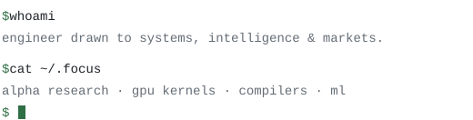

### Hey, I'm Armaan 👋

<code>building things from scratch · breaking them · figuring out why</code>

<br>

<picture>
  <source media="(prefers-color-scheme: dark)" srcset="./assets/terminal-dark.svg">
  <source media="(prefers-color-scheme: light)" srcset="./assets/terminal-light.svg">
  
</picture>

#### `~/about`

- CS grad from IIT Hyderabad, Batch of '26.
- Quant Researcher by day: ML-driven trading strategies, and how alpha is found and how it decays.
- On the systems side: GPU kernel analysis and compiler-level optimisation, mostly around CUDA and LLVM.
- happiest building something from first principles just to see how it really works.

#### `~/projects`

<sub>the research i do at work stays private. these are the public bits.</sub>

- <sub><code>quant</code></sub>&nbsp; **[implied vs realised vol](https://github.com/Jitik12/MA4340_ProbabilityForFinance_Project)**<br>
  <sub>s&p 500 realised volatility against the vix. fits a garch and a mean-reverting volatility model, then compares them across calm and high-vol regimes.</sub>
- <sub><code>systems</code></sub>&nbsp; **[libc++ · vector&lt;bool&gt; hardening](https://github.com/Jitik12/llvm-project/tree/libcxx-vector-bool-assertions)**<br>
  <sub>an llvm-project branch that adds a libc++ test checking that out-of-bounds <code>vector&lt;bool&gt;::operator[]</code> trips the hardening assertions, for both the const and non-const overloads.</sub>
- <sub><code>ml research</code></sub>&nbsp; **[symbolic neural odes](https://github.com/Jitik12/CS3055_MiniProj_Sem6)**<br>
  <sub>datasets of gaussian-process-driven odes solved with torchdiffeq, plus held-out and extrapolation sets to test generalisation. swaps naive euler for rk-style integrators.</sub>
- <sub><code>nlp</code></sub>&nbsp; **[multilingual emotion detection](https://github.com/Jitik12/CS5803_NLP_Project)**<br>
  <sub>multi-label emotion classification in english and in hindi + marathi. compares bert, roberta and distilbert, and uses lime for interpretability.</sub>
- <sub><code>software</code></sub>&nbsp; **[cab pooling](https://github.com/Jitik12/cab_pooling)**<br>
  <sub>a flutter ride-pooling app with rider and driver ends, backed by a python service that keeps forming pools in the background.</sub>

#### `~/toolbox`

<picture>
  <source media="(prefers-color-scheme: dark)" srcset="https://skillicons.dev/icons?i=cpp%2Cpy%2Crust%2Cpytorch%2Clinux%2Cdocker&theme=dark&perline=6">
  <source media="(prefers-color-scheme: light)" srcset="https://skillicons.dev/icons?i=cpp%2Cpy%2Crust%2Cpytorch%2Clinux%2Cdocker&theme=light&perline=6">
  
</picture>

<code>+ cuda · llvm</code>

#### `~/activity`

<picture>
  <source media="(prefers-color-scheme: dark)" srcset="https://github-readme-stats.vercel.app/api?username=Jitik12&show_icons=true&hide_border=true&hide_title=true&hide_rank=true&bg_color=00000000&text_color=8b949e&icon_color=7fb38a">
  <source media="(prefers-color-scheme: light)" srcset="https://github-readme-stats.vercel.app/api?username=Jitik12&show_icons=true&hide_border=true&hide_title=true&hide_rank=true&bg_color=00000000&text_color=656d76&icon_color=2f6f45">
  
</picture>

<!-- #### `~/listening` -->

<!-- <sub><code>♫</code>&nbsp; usually something on loop while the kernels compile. check what's playing on <a href="https://open.spotify.com/user/YOUR_SPOTIFY_USER_ID">spotify</a>.</sub> -->

<br>

<details>
<summary><sub>nothing to see down here.</sub></summary>

```text
      ▄▀▄         ▄▀▄
     █   ▀▀▀▀▀▀▀▀▀   █
     █   ▄▄     ▄▄   █        meow.
    █    ▀▀  ▼  ▀▀    █
     █     ╰─┴─╯     █        you found the cat.
      ▀▄▄         ▄▄▀         it's been waiting for
         ▀▀▀▀▀▀▀▀▀            the build to finish too.
```

</details>
